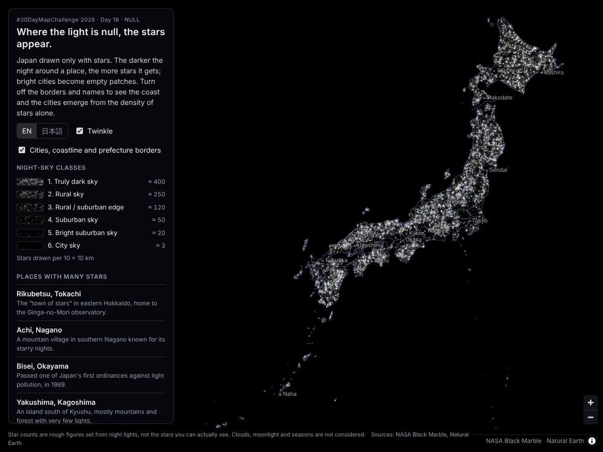

# Where the light is null, the stars appear.

**光がない場所に、星が現れる。**

#30DayMapChallenge 2026 Day 18「NULL」

Japan drawn only with stars. The darker the night around a place, the more stars it gets; bright cities become empty patches. Turn off the borders and names to see the coast and the cities emerge from the density of stars alone.

日本を星だけで描いた地図です。夜の明かりが少ない場所ほど星を多く、明るい街ほど少なく描いています。境界線と地名を消すと、星の濃淡だけで日本の形と街の位置が分かります。

**公開URL:** https://shinyanakashima.github.io/30daymapchallenge-2026day18-stars/



## 画面でできること

- 英語表記が標準で、日本語に切り替えられます（`?lang=ja` でも開けます）。
- 明るい星の一部が瞬きます（「Twinkle / 瞬き」で止められます。動きを減らす設定の端末では最初から止まっています）。
- 主な都市名、海岸線、都道府県境を重ねて表示します（最初から表示。「Cities, coastline and prefecture borders / 都市名・海岸線・都道府県境」で消せます）。都市名はズームに合わせて数を増やします。
- 地図をクリックすると、その地点の段階と、描いた星の数の目安（10km四方あたり）を表示します。
- 陸別町（十勝）、阿智村、美星町、屋久島、西表島・石垣島の5か所を紹介しています。
- スマートフォンでは、説明パネルが画面下にたためる形で表示されます。

## 処理の方法

1. **切り出し**: NASA Black Marble の年平均の夜間光（VNP46A4、2025年、`AllAngle_Composite_Snow_Free`、15秒格子、約500m）から、日本を含む10度タイル9枚（h30–32、v04–06）をつなぎ、東経122.5–149度、北緯24–46度を切り出します。
2. **ぼかし**: 街の光が周りの空まで明るくする様子の代わりに、ガウスぼかし（σ = 6km、半径15kmで打ち切り）をかけます。東西方向の幅は緯度に合わせて調整しています。物理的な計算はしていません。
3. **段階分け**: ぼかした明るさ（nW/cm²/sr）を6段階に分け、Natural Earth の日本の陸地の範囲だけを残します。
4. **星を散らす**: 段階ごとの密度（下の表）に従って、格子ごとに星の数をポアソン乱数で決め、格子の中にランダムに置きます。乱数の種は `18` に固定しているので、毎回同じ星空になります。星の大きさと明るさは4段階に分け、明るい星にはにじみを付けています。色は白、青白、黄みの4種類を割合を決めて割り当てています（色は見た目のためで、データとは関係ありません）。
5. **タイル化**: ズーム3〜10の XYZ タイル（512px、画面上は256px）に書き出します。ズームを下げるごとに描く星を約47%に間引き、全体表示でも濃淡が残るようにしています。最も明るい3,000個は、瞬きの表示用に GeoJSON にも書き出します。

### 段階と星の数の対応

星の密度は、ボートルスケールで紹介されている「肉眼で見える星のおおよその数」を1,000で割った値（1km²あたり）にしています。

| 段階 | ぼかした明るさ (nW/cm²/sr) | ボートルスケール | 見える星の目安 | 描いた星（10km四方） | 陸地に占める割合 |
|---|---|---|---|---|---|
| 1 とても暗い空 | 0.5 未満 | 1–2 | 3,000–5,000 | 約400 | 61.3% |
| 2 農村の空 | 0.5–1.5 | 3 | 2,000–3,000 | 約250 | 18.8% |
| 3 農村と郊外の境目 | 1.5–4 | 4 | 1,000–1,500 | 約120 | 11.2% |
| 4 郊外の空 | 4–10 | 5 | 400–700 | 約50 | 5.8% |
| 5 明るい郊外の空 | 10–30 | 6–7 | 100–300 | 約20 | 2.4% |
| 6 街の空 | 30 以上 | 8–9 | 20–50 | 約3 | 0.6% |

描いた星は全体で約116万個です。

## 注記

- 星の数は夜の明かりから決めた目安で、実際に見える星の数を計算したものではありません。
- 雲、月明かり、季節は考慮していません。
- 出典: NASA Black Marble、Natural Earth。

## データの出典

- **夜間光**: NASA Black Marble VNP46A4（VIIRS/NPP Lunar BRDF-Adjusted Nighttime Lights Yearly L3 Global 15 arc-second Linear Lat Lon Grid, Collection 2）、2025年。NASA LAADS DAAC から取得。パブリックドメイン。
- **海岸線・都道府県境・都市**: [Natural Earth](https://www.naturalearthdata.com/) 1:10m（Admin 0 Countries、Admin 1 States and Provinces、Admin 1 States and Provinces Lines、Populated Places）。パブリックドメイン。
- **地図表示**: [MapLibre GL JS](https://maplibre.org/) 4.7.1。

## 再現手順

```sh
pip install -r requirements.txt

# NASA Earthdata のトークン（https://urs.earthdata.nasa.gov/ で発行）
export EARTHDATA_TOKEN=...

python scripts/fetch_data.py --year 2025   # 夜間光と Natural Earth を data/raw/ に取得
python scripts/make_classes.py             # ぼかし・段階分け → data/processed/, site/data/
python scripts/make_tiles.py               # 星を散らしてタイル化 → site/tiles/

cd site && python -m http.server 8000      # http://localhost:8000/ で確認
node scripts/check_site.js http://localhost:8000/ docs   # Playwright でエラー確認とスクリーンショット
```

段階の区切りや密度は `scripts/config.py` にまとめています。

`data/processed/sky_class.png`（段階の格子）はリポジトリに含めています。GitHub Actions はこれを使って `make_tiles.py` でタイルを作り、GitHub Pages にデプロイします（`.github/workflows/pages.yml`）。そのため、デプロイに Earthdata の認証情報は必要ありません。

## ライセンス

コードは [MIT License](LICENSE)。
